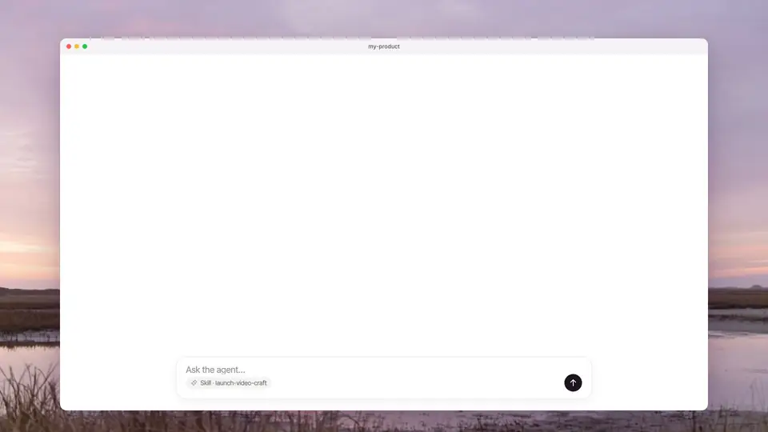

<p align="center">
  <a href="README.md"></a>
  <a href="README.ja.md"></a>
</p>

<p align="center">
  
</p>

<h1 align="center">Launch Video Craft</h1>

<p align="center">
  本物のプロダクト UI を、AI コーディングエージェントで磨かれたローンチ動画にする。
</p>

<p align="center">
  <a href="https://github.com/jammaru/launch-video-craft/releases/tag/v1.0.0"></a>
  <a href="https://skills.sh/jammaru/launch-video-craft"></a>
  <a href="LICENSE"></a>
</p>

Cursor、Claude Code、Codex、GitHub Copilot など、[skills CLI](https://www.npmjs.com/package/skills) が対応するエージェント向けの Agent Skill です。本物の UI から Remotion のローンチ動画まで進め、クリック位置、ズーム、フレームも確認します。順番は verify、review、render です。

## Demo

<p align="center">
  
</p>

Launch Video Craft で作った動画です。

| EmDash Preflight | ChatGPT |
| :---: | :---: |
| [](https://x.com/jammaru_lab/status/2105501576437678510?s=20) | [](https://x.com/jammaru_lab/status/2108406681839554662?s=20) |

## インストール

```bash
npx skills add jammaru/launch-video-craft
```

すべてのプロジェクトで使う場合は `-g` を付けます。

```bash
npx skills add jammaru/launch-video-craft -g
```

更新:

```bash
npx skills update launch-video-craft
```

以前の名前は `launch-video-skills` と `launch-video-method` です。インストールも更新も `launch-video-craft` を使います。

### GitHub CLI

`gh skill` は [GitHub CLI](https://docs.github.com/en/copilot/how-tos/use-copilot-agents/cloud-agent/create-skills) 2.90.0 以降です。

```bash
gh skill install jammaru/launch-video-craft launch-video-craft --scope user
gh skill update launch-video-craft
```

### Claude Code プラグイン

```text
/plugin marketplace add jammaru/launch-video-craft
/plugin install launch-video-craft@launch-video-craft
```

## なぜ Launch Video Craft か

公開しているのは、エージェントに雑なローンチ動画を出させないための制作工程です。

- 映像にはプロダクトの本物の UI を使う。
- テンポとカメラは参考クリップから取る。
- 映像は Remotion で組む。
- クリック、ズーム、フレームを実画面と照合する。
- render は最後。verify、review、render の順で進む。

## 使い方

最初はざっくりで大丈夫です。参考動画とロゴを添え、Remotion で作ることと、`launch-video-craft` に従うことを書けば、エージェントが一通り作り始めます。参考動画はテンポや見せ方の参考にし、シーンの数や順番をそろえる必要はありません。

できあがった映像を見て、違和感のあるところ（テンポ、ズームの位置、文言、映したい画面の順番など）をそのまま指示し、直してもらう——その往復で十分です。最初の依頼で全部を完璧に書く必要はありません。

詳しく書けるなら、伝えたいこと、入れたいシーンとその順番、各シーンで観客に何を伝えるか、尺や言語、必ず映したい画面も書いてあると近づきます。画面は製品の実際の UI を使うよう依頼してください。似た画面を後から描き直すのではなく、本物の画面やコマンドの出力を映します。

```text
このプロダクトのローンチ動画を Remotion で作って。参考はこの動画、ロゴはこのファイル。
実際の UI を使って。launch-video-craft に従って。
〇〇を伝えたい。ロゴのあと Playground で△△を見せ、最後にインストール。
```

手順そのものは [`skills/launch-video-craft/SKILL.md`](skills/launch-video-craft/SKILL.md) にあります。

## ウェブサイト

[launch.jammaru.com](https://launch.jammaru.com)

サイトは [`website/`](website/) にあります。そのディレクトリで `cf deploy` を実行すると公開されます。設定は `cloudflare.config.ts` です。

## リポジトリ構成

```text
.
├── skills/launch-video-craft/   # SKILL.md、reference.md、example*.md、kit/
├── website/                      # launch.jammaru.com
├── .claude-plugin/               # Claude Code プラグイン
├── assets/
└── scripts/check.py              # 公開前の静的チェック
```

## ライセンス

[MIT](LICENSE) — Copyright (c) 2026 [jammaru](https://github.com/jammaru)
