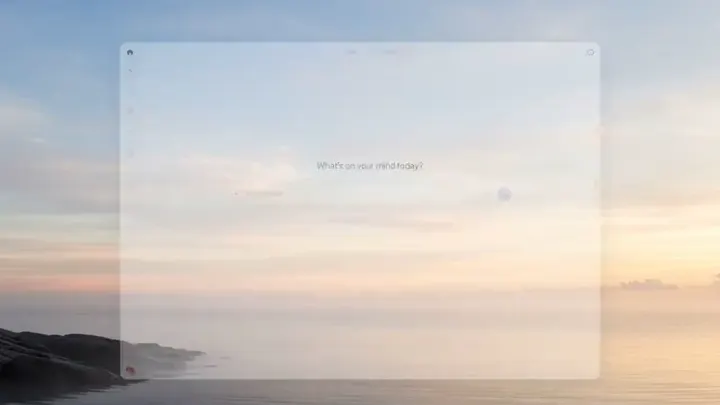

# Launch Video Craft

[](LICENSE)

## これは何？

自分でプロダクトを作ったら、ローンチのときに短いローンチ動画を作ることが多いと思います。一方で、SNS でよく見かけるおしゃれなローンチ動画を、ちゃんと作るのは難しい。

エージェントに「いい感じに作って」とだけ頼んでも、期待どおりの映像にはなりにくいです。実際の UI を使わず、勝手にそれっぽい画面を描いてしまう——そういうズレをなくす手順と判断の基準を [`skills/launch-video-craft/SKILL.md`](skills/launch-video-craft/SKILL.md) にまとめています。参考クリップのテンポに合わせ、**本物の製品画面**を Remotion で映すところまでです。

## このスキルで作った動画の例

| EmDash Preflight | ChatGPT |
| :---: | :---: |
| [](https://x.com/jammaru_lab/status/2105501576437678510?s=20) | [](https://x.com/jammaru_lab/status/2108406681839554662?s=20) |

## インストール

### 1. `npx skills add`（推奨）

```bash
npx skills add jammaru/launch-video-craft
```

すべてのプロジェクトで使う場合は `-g` を付けます。

```bash
npx skills add jammaru/launch-video-craft -g
```

更新:

```bash
npx skills update launch-video-craft
```

### 2. GitHub CLI

`gh skill` は GitHub CLI 2.97 以降です。

```bash
gh skill install jammaru/launch-video-craft launch-video-craft --scope user
gh skill update launch-video-craft
```

### 3. Claude Code プラグイン

```text
/plugin marketplace add jammaru/launch-video-craft
/plugin install launch-video-craft@launch-video-craft
```

## 使い方

参考動画とロゴを添え、Remotion で作ることと、`launch-video-craft` に従うことを書きます。参考動画はテンポや見せ方の参考にし、シーンの数や順番をそろえる必要はありません。

動画で伝えたいこと、入れたいシーンとその順番、各シーンで観客に何を伝えるかも書いてあると、依頼の意図に近い作品になります。尺や言語、必ず映したい画面があれば、それも書きます。画面は製品の実際の UI を使うよう依頼してください。似た画面を後から描き直すのではなく、本物の画面やコマンドの出力を映します。

```text
このプロダクトのローンチ動画を Remotion で作って。参考はこの動画、ロゴはこのファイル。
実際の UI を使って。launch-video-craft に従って。
〇〇を伝えたい。ロゴのあと Playground で△△を見せ、最後にインストール。
```

## リポジトリ構成

```text
.
├── skills/launch-video-craft/   # SKILL.md、reference.md、example*.md、kit/
├── .claude-plugin/               # Claude Code プラグイン
├── assets/
└── scripts/check.py              # 公開前の静的チェック
```

## ライセンス

[MIT](LICENSE) — Copyright (c) 2026 [jammaru](https://github.com/jammaru)
